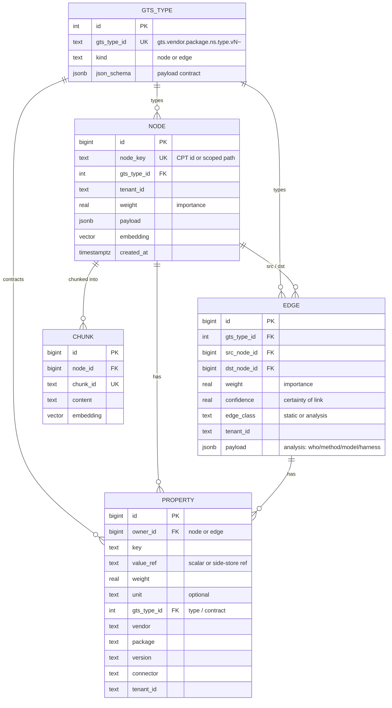

# Technical Design — Construct (Fabric)

<!-- toc -->

- [1. Architecture Overview](#1-architecture-overview)
  - [1.1 Architectural Vision](#11-architectural-vision)
  - [1.2 Architecture Drivers](#12-architecture-drivers)
  - [1.3 Architecture Layers](#13-architecture-layers)
- [2. Principles & Constraints](#2-principles--constraints)
  - [2.1 Design Principles](#21-design-principles)
  - [2.2 Constraints](#22-constraints)
- [3. Technical Architecture](#3-technical-architecture)
  - [3.1 Domain Model](#31-domain-model)
  - [3.2 Component Model](#32-component-model)
  - [3.3 API Contracts](#33-api-contracts)
  - [3.4 Internal Dependencies](#34-internal-dependencies)
  - [3.5 External Dependencies](#35-external-dependencies)
  - [3.6 Interactions & Sequences](#36-interactions--sequences)
  - [3.7 Database schemas & tables](#37-database-schemas--tables)
  - [3.8 Deployment Topology](#38-deployment-topology)
  - [3.9 Authorization Model](#39-authorization-model)
  - [3.10 Data Protection](#310-data-protection)
- [4. Additional context](#4-additional-context)
- [5. Traceability](#5-traceability)

<!-- /toc -->

**ID**: `cpt-cf-construct-design`

> Status: **draft for review** (graph reframe, 2026-08-12). Supersedes the
> pre-graph Construct architecture. Captures decisions and open questions from the
> 2026-08-11 design call, updated against Vasyl's `studio-graph-storage` reference
> implementation. This is the Rust, Fabric-native Construct
> (`constructorfabric/construct`), a **Fabric gear**; it is a distinct system from
> the legacy Python construct (`rolos` / hub `docs/construct/`, prefix
> `cpt-roloscyber-construct-*`).

## 1. Architecture Overview

### 1.1 Architectural Vision

Construct is an **engine that projects an abstract fact graph into a structured
profile**. It gathers every fact it can about an entity — a person, a product,
an organization — records the relationships between those facts as a graph, and
lets a caller run a query template against that graph to receive a structured
profile. *Developer? Here is the query. Learner? Here is the query. In return you
get the structured profile.*

Construct is **not a hard-coded product**; it is an engine on which owners build
their own constructs from **templates**. A construct owner cannot be anticipated a
priori — a software company wants developer profiles built from commits and
message tone; a law firm wants every contract and email retained in full.
Construct ships an engine plus a small set of ready templates and lets owners
**tailor them or author their own**: we ship a software-developer template, the
owner narrows it to a Python/C++/Rust or FE/BE developer; we ship nothing for
lawyers, the owner writes a lawyer template from scratch. Templates are declared
data, not code (see §2.1).

Three properties define the product:

- an **open-source, alienable core** — because the engine is open source, an owner
  is never locked into someone else's deployment: they can leave it, stand up their
  own deployment of the open-source engine, and **restore their exported data**
  into it;
- a construct is a **`(schema, extraction algorithm)` pair, versioned in parallel**
  over the same data;
- it is a **weighted projection, not exhaustive collection**.

Construct, Insight and Studio are three projections of one problem: gather
information about entities, then present it as action items (Insight), an
analytical view (Studio), or an explanatory profile (Construct).

### 1.2 Architecture Drivers

#### Functional Drivers

- **Describe a type once, compare instances of that type.** Entity and
  relationship types are declared in the **GTS (Global Type System)** — the same
  type system Fabric gears use (`libs/toolkit-gts` + the Types Registry gear) —
  so an owner defines a type once and can then compare instances (product
  competitors; best-practice transfer between organizations; developer
  assessment).
- **Collect facts from many heterogeneous sources.** Facts arrive from external
  systems through **connectors**, realised on Fabric's plugin model (a host gear
  SDK + scoped `ClientHub` clients; cf. the `llm-gateway` provider plugins). The
  same attribute may arrive from several sources in conflicting formats; GTS
  validation reconciles them at the door.
- **Produce a structured, explanatory profile** answering qualitative questions
  ("how strong a developer", "why did output drop"), not just quantitative trends.
- **Audience-specific views are ordinary constructs.** The same entity projected
  for colleagues vs friends vs instructors is not a special primitive — it is a
  different construct/query template over the same facts (see §3.1).
- **Let owners define custom templates.** A template marketplace is a possible
  future, out of scope for v1.

#### NFR Allocation

| NFR                                 | Allocation                                                                                                                                                                                    | Verification Approach                                                             |
| ----------------------------------- | --------------------------------------------------------------------------------------------------------------------------------------------------------------------------------------------- | --------------------------------------------------------------------------------- |
| Alienability / portability          | Open-source engine + open, dumpable store, so an owner can redeploy and restore an export (§2.2, [ADR-0001](ADR/0001-graph-storage-engine.md)).                                               | Export → fresh open-source deploy → restore, in CI.                               |
| Tenant isolation, governance, audit | Every operation mediated by the gear authorization model (§3.9); tenant/RG scoping enforced in SQL via the Toolkit secure data path (§3.4).                                                   | Policy tests per operation; `SecureConn` scope tests.                             |
| Cost / token efficiency             | Construct logic spends tokens **proportionally to the owner's chosen goal/budget** — a $5 good-enough construct or a $5000 "perfect" one are both valid targets (§3.2 L4).                    | Per-construct token/cost budget assertions.                                       |
| Scale                               | ~100s of millions of objects, ~500M edges per construct; billions aspirational — depth-bounded, not deep-traversal ([ADR-0001](ADR/0001-graph-storage-engine.md)).                            | Spike at low-hundreds-of-millions (not yet measured — see ADR-0001 Confirmation). |
| Privacy / PII governance            | Personal data carries a data-category tag; purpose-limited; subject-level `anonymize`/`extract`/erasure via the gear governance path (§2.2 `cpt-cf-construct-constraint-privacy-pii`, §3.10). | Data-protection review; erasure propagation tests.                                |
| Security                            | Every operation authenticated (AuthN Resolver) and authorized (PDP/PEP → `AccessScope`) through the gear authorization model (§3.9). Threat-model pass deferred to the security review gate.  | PEP-per-handler coverage; fail-closed tests.                                      |
| Reliability                         | Layer-4 workflows resumable from checkpoint; ingestion idempotent per `(connector, provenance, version)` so replays do not duplicate facts (§3.6).                                            | Replay/idempotency tests. Numeric SLOs deferred to DECOMPOSITION.                 |

Performance and observability are not silently omitted: latency/throughput budgets
and caching are deferred to DECOMPOSITION pending the ADR-0001 spike, and structured
logging, metrics, tracing and alerting are inherited from the Fabric gear runtime
(specifics in DECOMPOSITION).

#### Key ADRs

| ADR                                                        | ID                                           | Decision                             | Status                          |
| ---------------------------------------------------------- | -------------------------------------------- | ------------------------------------ | ------------------------------- |
| [ADR-0001](ADR/0001-graph-storage-engine.md)               | `cpt-cf-construct-adr-graph-storage-engine`  | Graph storage engine class           | proposed (Option 2 recommended) |
| [ADR-0002](ADR/0002-graph-construction-weighting-model.md) | `cpt-cf-construct-adr-graph-weighting-model` | Graph construction & weighting model | proposed (open)                 |

### 1.3 Architecture Layers

The engine is four layers. The first three are "dumb but robust" infrastructure;
the fourth is where product value and differentiation live. Whether layer 3 is a
single template-built graph or a raw store written by a separate **construct-builder**
(with a **construct-querier** as layer 4) is the subject of
[ADR-0002](ADR/0002-graph-construction-weighting-model.md); note that under a
builder/querier split the "dumb layer 3" premise itself becomes contingent, because
weight-baking would move into layer 3.

| #   | Layer                        | Purpose                                                                                           | Sourcing                                                    |
| --- | ---------------------------- | ------------------------------------------------------------------------------------------------- | ----------------------------------------------------------- |
| 1   | **GTS contracts**            | Global Type System: schema, validation, per-attribute provenance                                  | Reused from Fabric (`libs/toolkit-gts` + Types Registry)    |
| 2   | **Connectors (plugins)**     | Integrations that collect facts and bring their own schema, on Fabric's plugin model              | Some reused from Insight, some written per source           |
| 3   | **Graph store**              | Property graph of nodes/edges/weighted-properties; validates contracts on insert; stores at scale | See [ADR-0001](ADR/0001-graph-storage-engine.md)            |
| 4   | **Construct-logic workflow** | The "art": query the graph, summarise under cost/quality budget, emit the versioned construct     | Built here; candidate for Fabric serverless durable runtime |

#### Technology Risks

- **Apache AGE PostgreSQL-16 ceiling.** AGE 1.5.0 targets PG16 only; there is no
  PG17 release. Mitigated by keeping relational tables the source of truth and AGE
  a swappable traversal mirror (ADR-0001).
- **pgvector at target scale.** Co-located vector search is unproven at
  low-hundreds-of-millions; the ADR-0001 spike must confirm it.
- **GTS upstream spec instability.** The upstream GTS spec URL is cited
  inconsistently across the monorepo; Construct depends on the in-repo
  `libs/toolkit-gts` rather than an external URL.

## 2. Principles & Constraints

### 2.1 Design Principles

#### Engine, not product

**ID**: `cpt-cf-construct-principle-engine-not-product`

The **engine** embeds no construct scenario. Scenarios are **data** — templates,
some shipped with the engine (declared as migrations or JSON), some authored by
owners. "Shipped" templates are pre-defined data, not hard-coded product logic;
the engine treats them the same as an owner's own.

#### Collector / interpreter separation

**ID**: `cpt-cf-construct-principle-collector-interpreter-split`

Those who *collect* data (connectors, living outside as plugins) and those who
*interpret* it (construct logic) are different actors with different needs. The
workers live outside and push data in; the store only stores. The GTS contract
sits between them as the enforcement point — the "policeman" that rejects data an
interpreter could not use (e.g. a phone number with no leading `+`).

#### Provenance is intrinsic

**ID**: `cpt-cf-construct-principle-intrinsic-provenance`

Every attribute records which connector, vendor, package, type and version
produced it. There is no bare "the phone number" field; there are per-source,
versioned values.

#### Weights and confidence are first-class

**ID**: `cpt-cf-construct-principle-weights-first-class`

Construct is a **weighted** projection — importance is what lets the logic layer
prune to what matters, the core distinction from Insight. This principle fixes only
that importance is *first-class, not incidental*; **where** a weight lives — baked
into the stored graph or applied at query time — is decided in
[ADR-0002](ADR/0002-graph-construction-weighting-model.md). Edges additionally carry
**confidence** (certainty that the relationship holds): we may not know an entity is
really related to a fact (the post's author merely shares a name), and that
uncertainty must be representable separately from importance.

#### Reuse the platform

**ID**: `cpt-cf-construct-principle-reuse-platform`

Tenant isolation, authn/authz, governance, audit and the data path come from the
**Gears Toolkit** libraries (`libs/toolkit-*`) and the Fabric system gears
(AuthN/AuthZ resolvers, Types Registry, …), not bespoke implementations.

#### Reversible storage

**ID**: `cpt-cf-construct-principle-reversible-storage`

The logic layer addresses the graph through an interface, so the engine can be
swapped (see [ADR-0001](ADR/0001-graph-storage-engine.md)). In the reference
implementation the relational tables are the source of truth and the graph engine
is a mirror, so it can be dropped without data loss.

### 2.2 Constraints

#### Language and runtime

**ID**: `cpt-cf-construct-constraint-rust-postgres`

Rust, packaged as a **Fabric gear**. Data access goes through the Toolkit secure
data path — **`SecureConn` + `AccessScope` over SeaORM** (`libs/toolkit-db`) — not
a bespoke driver layer. This constraint governs the **operational/platform data**
and does **not** predecide the **graph-store** engine (§3.2 L3), which is open in
[ADR-0001](ADR/0001-graph-storage-engine.md).

#### Reused platform libraries

**ID**: `cpt-cf-construct-constraint-reuse-rust-libs`

Tenant isolation, authn/authz, governance and audit are provided by the Gears
Toolkit libraries (`libs/toolkit-*`) and the Fabric system gears and must not be
re-implemented.

#### GTS adopted as-is

**ID**: `cpt-cf-construct-constraint-gts-as-is`

Construct adopts the Global Type System via `libs/toolkit-gts` and registers its
types through the Types Registry gear; it does not define its own type system. The
GTS `type_uuid` (UUIDv5) derivation is shared with the Rust implementation
(pinned in the account-management gear), making a type identity portable across
services.

#### Alienability

**ID**: `cpt-cf-construct-constraint-alienability`

The storage and engine choice must let an owner export data and redeploy the
open-source engine standalone, then restore that export.

#### Heavy properties live in the side store

**ID**: `cpt-cf-construct-constraint-side-store`

Large properties/documents live in the existing bronze/silver/gold layers, not
inline in the graph.

#### Vector search beside the graph

**ID**: `cpt-cf-construct-constraint-vector-beside-graph`

A vector capability sits beside the graph. Two relevance mechanisms are in play
and their relationship is **not yet settled** (see §4 open questions): hybrid
retrieval that fuses lexical + vector arms by reciprocal rank (the reference
implementation), and a small purpose-trained **LLM relevance judge** operating
over a single entity's bounded fact set. They may be complementary; ADR-0001 calls
for a benchmark rather than assuming one supersedes the other.

#### Privacy and PII governance

**ID**: `cpt-cf-construct-constraint-privacy-pii`

Construct ingests personal data about identifiable people, so privacy is a
first-class constraint, not an afterthought. Every attribute carries a
data-category classification; collection is purpose-limited and retained under a
per-tenant policy; and the authorization model must support subject-level
`anonymize`, `extract` and hard erasure ("right to be forgotten"). This is
enforced through the gear governance/audit path
(`cpt-cf-construct-constraint-reuse-rust-libs`), not bespoke code. Erasure
interacts with the still-open `write`/`delete` operation set (§3.3) — deletion
propagation to the bronze/silver/gold side store is an open item (§3.10).

## 3. Technical Architecture

### 3.1 Domain Model

Core graph primitives (property-graph model). **Types are data, not code**: node
and edge types are GTS types registered in a type registry, and a type's JSON
Schema defines which properties its instances may carry — so a type is not just a
label, it is the payload contract. Owners register their own node/edge types.

Importance **weights** shown below are intrinsic to the stored graph under ADR-0002's
Option 1/hybrid; under Option 2 they are supplied by the query rather than stored
(see [ADR-0002](ADR/0002-graph-construction-weighting-model.md)).

- **Node** — an instance of a registered node type: a person, product,
  organization, email, pull request, social post. The type (not a fixed
  enumeration) says what a node may be and what properties it must satisfy; like
  edges and properties it may carry a **weight** (importance; see the note above).
- **Edge** — a typed, directed relationship carrying a **weight** (importance) and
  a **confidence** (certainty the relationship holds). Edge types declare their
  admissible source and target types. Edges come in two kinds:
  - **static** — what the sources state (`authored`, `manages`, `owns`,
    `member-of`, `mentions`); recomputed on re-ingest;
  - **analysis** — conclusions *derived* about the entity; they require provenance
    (who/method/model/harness) and survive re-ingest. This is the extension point
    for an LLM analyzer.
- **Property** — an attribute of a node or edge, stored *separately*, carrying
  value + **weight** + **type/contract** + optional **unit** + GTS **provenance**
  (vendor/package/type/version + connector). Large properties (documents) live in
  the side store, referenced by ID.

Higher-level concepts: a **Construct** is `(schema, extraction algorithm, version)`, many versions coexisting over one graph; a **Template** bundles a
construct schema/algorithm plus the connectors and bronze-layer contracts it
depends on. Audience-specific views (manager vs dev-lead) are **just different
constructs/queries**, not a separate primitive. *(Future, out of scope for v1: a
"graph of constructs" linking constructs into a social graph — deferred until the
single-graph case is complete.)*

### 3.2 Component Model

```
Connectors ──▶ [GTS validate] ──▶ Graph Store ──▶ Construct-Logic ──▶ Construct output
 (plugins,L2)      (L1)             (L3)              (L4)            (structured profile)
    │                                  │                  │
    └── bring schema            nodes/edges/          query +
        + provenance            weighted props        weighted summarisation
                                   │                      │
                        properties/documents ──▶ bronze/silver/gold side store
```

Whether the graph is one template-built store or a raw store written by a separate
**construct-builder** (a candidate L3-writing component) that a **construct-querier**
then reads is deferred to
[ADR-0002](ADR/0002-graph-construction-weighting-model.md); under that split the
"dumb layer 3" premise (§1.3) is itself contingent. The component descriptions below
stay neutral on that axis: the builder, if adopted, writes into L3 and is not part
of the L4 querier.

#### GTS Contracts (L1)

**ID**: `cpt-cf-construct-component-gts`

##### Why this component exists

The same entity/attribute is inserted by many connectors in conflicting formats;
without a validated contract, interpreters downstream cannot rely on the data.

##### Responsibility scope

Define schemas + versions (vendor/package/type/version), validate every insert
against the declaring type's contract (JSON Schema, walking the derivation chain),
attach per-attribute provenance.

##### Responsibility boundaries

Does not collect data (connectors do) and does not interpret it (construct logic
does); it only defines and enforces contracts. Adopted from Fabric
(`libs/toolkit-gts` + Types Registry gear).

##### Related components (by ID)

Enforced at the boundary of `cpt-cf-construct-component-graph-store`; populated by
`cpt-cf-construct-component-connectors`.

#### Connectors (L2)

**ID**: `cpt-cf-construct-component-connectors`

##### Why this component exists

Facts live in external systems (M365, GitHub, Zulip, social, HR/AD); something
must collect them and map them onto GTS schemas.

##### Responsibility scope

One connector per source, written roughly once, realised as a Fabric **plugin**
behind a host-gear SDK; each brings its own schema, declares what it enriches, and
pushes validated data in from outside.

##### Responsibility boundaries

Does not decide what is important (no weights) and does not store data; hands
validated records to the graph store. Some connectors are reused from Insight.
Whether "connector" and "Fabric plugin" fully coincide is an open question (§4).

##### Related components (by ID)

Produces data validated by `cpt-cf-construct-component-gts` and stored by
`cpt-cf-construct-component-graph-store`.

#### Graph Store (L3)

**ID**: `cpt-cf-construct-component-graph-store`

##### Why this component exists

The nodes/edges/weighted-properties must be stored at scale, validated on insert,
and served under depth-bounded weighted queries.

##### Responsibility scope

Persist nodes/edges/properties efficiently and securely; validate contracts on
insert; serve two-phase depth-bounded queries; enforce tenant isolation and audit
via the Toolkit secure data path.

##### Responsibility boundaries

Does not run construct logic; "dumb but robust". Heavy properties/documents are
delegated to the bronze/silver/gold side store. Engine choice is open — see
[ADR-0001](ADR/0001-graph-storage-engine.md); the leading option keeps relational
tables authoritative with a graph traversal mirror beside them.

##### Related components (by ID)

Consumes contracts from `cpt-cf-construct-component-gts`; queried by
`cpt-cf-construct-component-construct-logic`.

#### Construct-Logic Workflow (L4)

**ID**: `cpt-cf-construct-component-construct-logic`

##### Why this component exists

Turning a graph into a qualitative, cost-bounded profile is the product's
differentiator and its "art".

##### Responsibility scope

Query the graph, fetch details on demand, summarise under a cost/quality budget
proportional to the owner's goal, emit and store the versioned construct; support
many construct versions over one graph. Under ADR-0002 this L4 workflow is the
**querier** (it reads and projects); a separate **construct-builder** — an
L3-writing component, not part of L4 — may write the weighted graph.

##### Responsibility boundaries

Does not own storage or contracts; addresses the graph only through its interface.
Candidate host: the Fabric serverless durable runtime.

##### Related components (by ID)

Queries `cpt-cf-construct-component-graph-store`; emits constructs governed by the
authorization model (§3.9).

### 3.3 API Contracts

Filesystem analogy — Construct exposes **data**, **operations over data**, and an
**access/governance model** (§3.9). Operation set (to be finalised — flagged by
Ivan in the call):

- `read`, `share`, `anonymize`, `transfer`, `extract`, `compare` (compare two
  constructs of the same type).
- `write` / `delegate-write` — **missing from the current draft, to be added.**
- `subscribe` / `notify` — event when a construct changes, so subscribers react.
  **To be added.**

Every operation is mediated by the authorization model (§3.9): *who* may perform
*which* operation on *which* data category under *which* permissions, with an
audit (access-log) entry. Inter-gear calls go through the SDK facade + `ClientHub`
(in-process or gRPC, chosen by config), propagating the `SecurityContext`.

### 3.4 Internal Dependencies

- **GTS** — `libs/toolkit-gts` + the Types Registry gear; contract/type system,
  layer 1.
- **Toolkit secure data path** — `libs/toolkit-db` (`SecureConn` + `AccessScope`
  over SeaORM) for tenant/RG-scoped access.
- **AuthN / AuthZ resolver gears** — authentication and PDP/PEP authorization
  (§3.9).
- **bronze/silver/gold storage** (Insight lineage) — raw/refined document store
  beside the graph.
- **Graph store engine** — options in [ADR-0001](ADR/0001-graph-storage-engine.md)
  (leading: Postgres + pgvector + Apache AGE mirror, per Vasyl's
  `studio-graph-storage`; alternative: the older Insight NebulaGraph
  `graph-storage`).
- **Vector store** — co-located pgvector in the leading option. (The Qdrant
  precedent belongs to an unrelated legacy Model-Engine service, not Fabric —
  context only; see [ADR-0001](ADR/0001-graph-storage-engine.md).)
- **Fabric serverless durable runtime** — candidate host for layer 4 workflows
  (resumable from checkpoint, orchestrated so only N run per entity).

### 3.5 External Dependencies

#### Source systems (via connector plugins)

Microsoft 365, GitHub, Zulip, social networks (Facebook/X), HR / Active
Directory, and other per-source integrations.

#### LLM providers

Extraction, summarisation and the relevance judge, across cost tiers (cheap vs
expensive models, shallow vs deep content analysis). The per-entity relevance
judge is a small purpose-trained model (Qwen-3.5-4B, FP8) operating over one
entity's bounded fact set.

### 3.6 Interactions & Sequences

#### Ingestion (connector → graph)

**ID**: `cpt-cf-construct-seq-ingestion`

Actors: **Connector author** (builds the plugin); **System** (ingest pipeline).

1. A connector (plugin) collects facts and maps them to its declared GTS schema
   (attaching vendor/package/type/version + connector provenance).
1. It pushes them into the graph store; GTS validates the contract; violations are
   rejected, valid data is written as nodes/edges/properties; large properties go
   to the side store and are referenced by ID. Re-ingest is idempotent per
   `(connector, provenance, version)`; static edges are recomputed, analysis edges
   preserved.

#### Construct projection (query → profile)

**ID**: `cpt-cf-construct-seq-projection`

Actors: **Consumer** (requests the profile); **Subject** (the entity profiled).

1. The logic layer issues a depth-bounded query ("everything about entity X to
   depth N") and receives a list of typed IDs.
1. It requests details for a weight-ranked subset (e.g. the top 10) from the side
   store.
1. It summarises under a cost/quality budget proportional to the owner's goal
   (reusing prior summaries), writes the summary back as a derived (analysis)
   fact, and assembles the final structured construct.
1. The construct is stored; multiple versions may run this pipeline differently
   over the same graph.

### 3.7 Database schemas & tables

Logical schema (provisional — physical form depends on
[ADR-0001](ADR/0001-graph-storage-engine.md)), grounded on the reference
implementation. Graph tables stay lean (IDs, edges, weights, confidence); heavy
values live in the side store. Node/edge **types are rows in a registry**, and a
type's JSON Schema constrains the payload of its instances — so an instance's type
and property set are validated, never arbitrary. The `weight` columns assume
ADR-0002 Option 1/hybrid; under Option 2 importance is query-supplied, not stored.



#### Table: gts_type

The type registry. Columns (logical): `id`, `gts_type_id`, `kind` (node|edge),
`json_schema`. Every node/edge references a row here; validation walks the type's
derivation chain.

#### Table: nodes

Typed objects. Columns (logical): `id`, `node_key`, `gts_type_id`, `tenant_id`,
`weight`, `payload`, `embedding`, `created_at`. Tenant-scoped via the secure data
path.

#### Table: edges

Typed, directed relationships. Columns (logical): `id`, `gts_type_id`,
`src_node_id`, `dst_node_id`, `weight`, `confidence`, `edge_class`
(static|analysis), `payload`, `tenant_id`.

#### Table: properties

Node/edge attributes with provenance and contract. Columns (logical): `id`,
`owner_id`, `key`, `value_ref` (inline scalar or side-store document reference),
`weight`, `unit`, `gts_type_id`, `vendor`, `package`, `version`, `connector`,
`tenant_id`.

#### Table: chunks

Document content extracted for search. A node's large text/documents are split into
chunks, each embedded, so hybrid lexical+vector retrieval (ADR-0001) can match a
passage and fold it up to its node. Columns (logical): `id`, `node_id`, `chunk_id`,
`content`, `embedding`. Distinct from `nodes.embedding` (a node-level vector): chunks
give passage-level provenance, and the heaviest documents are referenced from the
bronze/silver/gold side store rather than duplicated inline.

### 3.8 Deployment Topology

Construct deploys as a **Fabric gear**. One codebase runs in the standard Fabric
shapes, selected by config: **single-node** (one process, `ClientHub` in-process),
**multi-node** (gRPC across gears, `SecurityContext` over headers), and
**Kubernetes** (designed in the Toolkit but not yet shipped — not relied on here).
Inbound traffic enters through the **API Gateway** (AuthN middleware → routing);
each gear owns its database, accessed through the secure data path. Layer 4 may
deploy on the Fabric serverless durable runtime. **Detail pending the storage and
runtime decisions.**

### 3.9 Authorization Model

Construct reuses Fabric's **PDP/PEP** authorization (NIST SP 800-162), not a
bespoke access layer:

- **AuthN** — the API Gateway's AuthN middleware calls the **AuthN Resolver** gear
  (JWT validation via a vendor plugin), producing a `SecurityContext` carried on
  the request.
- **AuthZ (PEP → PDP)** — the domain layer calls a `PolicyEnforcer` (the PEP),
  which asks the **AuthZ Resolver** gear (the PDP); a policy plugin returns a
  decision + constraints compiled into an **`AccessScope`**. Fail-closed.
- **Secure data path** — all queries run through `SecureConn.scope_with(scope)`,
  so tenant/resource-group predicates and PDP constraints are applied in SQL; gears
  never touch a raw connection.

Every **defined** Construct operation (§3.3) is a PEP entry point with an audit
entry; the still-missing `write`/`delete` operations (§3.3) will be too once
finalised — the erasure path in §3.10 depends on them.

### 3.10 Data Protection

Construct holds personal data, so data protection is explicit:

- **Data-category tagging** — every attribute carries a category used by policy and
  retention.
- **Subject rights** — `anonymize`, `extract`, and hard **erasure** operate at the
  subject level through the authorization model.
- **Erasure propagation** — deleting a subject must cascade from the graph to the
  bronze/silver/gold side store; this propagation is an **open item** tied to the
  still-missing `write`/`delete` operations (§3.3).
- **Purpose limitation & retention** — collection is purpose-limited and retained
  per tenant policy.
- **Encryption & key management** — encryption at rest and in transit and key
  management are inherited unchanged from the Fabric platform / secure data path
  (§3.4), not implemented bespoke here.

## 4. Additional context

**Actors** (interim, temporary exception — the formal home per the gear convention
is the PRD; §3.6 sequences reference these by name and will switch to
`cpt-cf-construct-actor-*` IDs when the PRD lands, at which point this list is
removed):

- **Construct owner** — deploys the engine, chooses/authors templates.
- **Connector author** — writes a connector plugin for a source.
- **Template author** — defines a construct schema/algorithm.
- **Consumer** — the developer/learner/manager querying for a profile.
- **Subject** — the person the profile is about (privacy rights holder).
- **System / agents** — analyzers that derive analysis edges.

**Distinction from Insight.**

|            | Insight                              | Construct                             |
| ---------- | ------------------------------------ | ------------------------------------- |
| Collection | everything, link everything          | weighted; prune to what matters       |
| Output     | trends / quantitative, no conclusion | qualitative verdict + explanation     |
| Traversal  | operational, exhaustive              | weighted summarisation, depth-bounded |
| Weights    | none                                 | on nodes, edges, properties           |

**Open questions** (agenda for the Insight/Studio session and Friday review):

1. **Graph engine (ratification, not re-choice)** — ADR-0001 recommends Option 2
   (Postgres + pgvector + Apache AGE mirror); the open item is ratifying it via the
   scale spike and the Insight/Studio session, not re-selecting between it and
   NebulaGraph ([ADR-0001](ADR/0001-graph-storage-engine.md)).
1. **Graph construction & weighting** — one template-built weighted graph with
   query-time weight overrides (projections; refresh/duplication cost) vs a single
   raw graph with all weights applied at query time (no projections, slower). See
   [ADR-0002](ADR/0002-graph-construction-weighting-model.md).
1. **Relevance mechanism** — does hybrid lexical+vector RRF replace, or complement,
   the per-entity LLM relevance judge? Benchmark both on quality and latency
   (ADR-0001).
1. **Connectors vs Fabric plugins** — do "connectors" fully coincide with the
   Fabric plugin model, or is there a Construct-specific connector abstraction
   above it?
1. **Output shape** — a **structured/hybrid tree**, not a flat fact list: a
   hierarchy where each node carries required properties (category,
   source/provenance, applicable context). Required-property schema to finalise.
1. **Operation set** — add `write`/`delegate-write` and `subscribe`/`notify`
   (Ivan); finalise the list and permission mapping.
1. **Template scope** — which role templates ship in v1 (developer, learner,
   researcher); lawyer and others deferred; marketplace out of scope for v1.
1. **Workflow runtime** — plain logic-over-graph for v1 vs Fabric serverless
   durable runtime; orchestration limits (≤ N concurrent workflows per entity).
1. **Insight infra reliance** — can Construct rely on the Insight team's graph
   infrastructure, or must it own the infra? Affects roadmap and query complexity.

## 5. Traceability

- **[ADR-0001: Graph Storage Engine](ADR/0001-graph-storage-engine.md)**
  (`cpt-cf-construct-adr-graph-storage-engine`) — realises §3.2 (Graph Store) and
  §3.7 / layer 3.
- **[ADR-0002: Graph construction & weighting model](ADR/0002-graph-construction-weighting-model.md)**
  (`cpt-cf-construct-adr-graph-weighting-model`) — realises the L3/L4 construction
  question behind §3.2 and §1.3.
- Internal chain: the principles (§2.1) and constraints (§2.2) realise the drivers
  in §1.2; the components (§3.2) and sequences (§3.6) realise the layers in §1.3.
  The privacy/PII constraint (`cpt-cf-construct-constraint-privacy-pii`) and the
  Privacy/PII, Security and Reliability NFRs (§1.2) are realised by the
  authorization model (§3.9) and data protection (§3.10).
- Downstream (to author): PRD (PM-owned, in progress; formal Actors home),
  DECOMPOSITION, and per-layer FEATURE docs.
- Source: graph-reframe design call, 2026-08-11; Vasyl's `studio-graph-storage`
  reference implementation.
